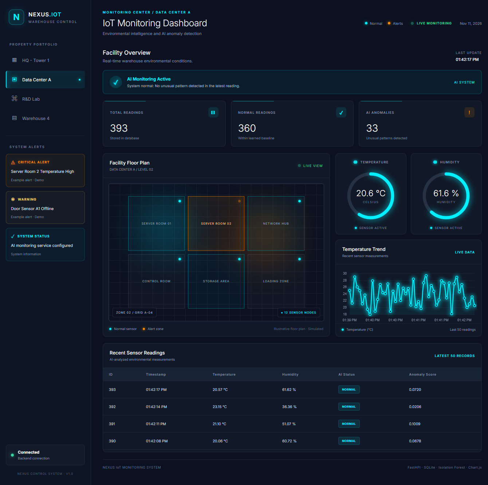

# NEXUS IoT — Smart Warehouse AIoT Monitoring System

A multi-facility environmental monitoring prototype combining machine learning and rule-based anomaly detection.

**Project:** Smart Warehouse AIoT Monitoring System  
**University:** Dalian Polytechnic University  
**Academic Year:** 2026–2027

## Project Overview

NEXUS IoT is a software-based AIoT monitoring prototype developed using Python, FastAPI, SQLite, and web technologies.

The system simulates temperature and humidity measurements for four facilities, stores readings in a database, and identifies unusual environmental conditions using a hybrid anomaly detection approach.

The hybrid system combines an Isolation Forest V2 machine learning model with configurable temperature and humidity rules.

**Important:** The project uses simulated sensor data. Physical sensors, MQTT communication, and production deployment are not implemented.

## Monitored Facilities

| Facility ID | Facility |
|---|---|
| `hq` | HQ - Tower 1 |
| `data-center` | Data Center A |
| `rnd` | R&D Lab |
| `warehouse` | Warehouse 4 |

Each facility has its own simulated readings and facility-specific monitoring information.

## Main Features

- Multi-facility temperature and humidity monitoring.
- Python-based environmental sensor simulation.
- SQLite database with facility identifiers.
- Isolation Forest V2 anomaly detection.
- Rule-based environmental threshold monitoring.
- Hybrid AI and rule-based anomaly classification.
- Detection source indicators.
- FastAPI REST endpoints.
- Facility-specific statistics and readings.
- Interactive dashboard with charts and gauges.
- Recent sensor readings and anomaly history.
- Automatic dashboard data updates every five seconds.
- Backend connection status monitoring.

## Technologies

| Component | Technology |
|---|---|
| Programming language | Python |
| Backend | FastAPI |
| Machine learning | Scikit-learn |
| AI algorithm | Isolation Forest |
| Feature scaling | StandardScaler |
| Model persistence | Joblib |
| Database | SQLite |
| Frontend | HTML, CSS, JavaScript |
| Visualization | Chart.js |
| API server | Uvicorn |

## System Architecture

The monitoring workflow is:

1. The Python simulator generates environmental readings for four facilities.
2. Measurements are stored in SQLite with facility identifiers.
3. Isolation Forest V2 analyzes environmental patterns.
4. Rule-based monitoring checks temperature and humidity limits.
5. Hybrid decision logic combines both detection results.
6. FastAPI provides monitoring data through REST endpoints.
7. The dashboard displays facility-specific measurements, charts, and anomaly alerts.

### Architecture Diagram


### Dashboard Preview



## Project Structure

```text
Smart_Warehouse_AIOT/
├── backend/
│   ├── ai_model.py
│   ├── ai_model_v2.py
│   ├── database.py
│   ├── main.py
│   ├── sensor.py
│   └── test_ai_model_v2.py
├── data/
├── documentation/
│   ├── architecture.md
│   ├── requirements.md
│   └── final_project_report.md
├── frontend/
│   ├── index.html
│   ├── script.js
│   └── style.css
├── models/
│   └── isolation_forest_v2.joblib
├── screenshots/
├── requirements.txt
└── README.md
```

## Installation and Setup

### 1. Clone the repository

```powershell
git clone https://github.com/louziatarik/Smart_Warehouse_AIOT.git
cd Smart_Warehouse_AIOT
```

### 2. Create a virtual environment

```powershell
python -m venv .venv
```

Activate the environment on Windows PowerShell:

```powershell
.\.venv\Scripts\Activate.ps1
```

### 3. Install dependencies

```powershell
python -m pip install -r requirements.txt
```

### 4. Start the backend

From the project root:

```powershell
python -m uvicorn main:app --reload --app-dir backend
```

Backend URL:

`http://127.0.0.1:8000`

API documentation:

`http://127.0.0.1:8000/docs`

### 5. Start the sensor simulator

Open a second terminal in the project root:

```powershell
python backend/sensor.py
```

The simulator generates temperature and humidity measurements for the four facilities.

### 6. Start the frontend

Open a third terminal in the project root:

```powershell
python -m http.server 5501 --bind 127.0.0.1 --directory frontend
```

Open the dashboard in your browser:

`http://127.0.0.1:5501/index.html`

The dashboard retrieves monitoring information automatically without requiring full-page reloads.

## Hybrid Anomaly Detection

The system uses two complementary detection methods.

### Isolation Forest V2

The trained AI model analyzes four features:

1. Temperature.
2. Humidity.
3. Absolute temperature change.
4. Absolute humidity change.

The model uses StandardScaler and Isolation Forest with 200 estimators and a contamination setting of 0.05.

The saved model is located at:

`models/isolation_forest_v2.joblib`

### Rule-Based Monitoring

The prototype uses these demonstration thresholds:

| Parameter | Minimum | Maximum |
|---|---|---|
| Temperature | 15°C | 30°C |
| Humidity | 30% | 70% |

These thresholds are not universal warehouse safety standards.

### Hybrid Classification

A reading is classified as anomalous when either the AI model or the rule engine detects an anomaly.

The dashboard identifies the detection source as AI, rules, or both.

## Testing

Run the controlled AI and hybrid monitoring scenarios from the project root:

```powershell
python backend/test_ai_model_v2.py
```

The tests include normal environmental conditions, high temperature, high humidity, and rapid temperature change.

These are functional scenario tests, not formal measurements of real-world model accuracy.

## API Endpoints

| Endpoint | Purpose |
|---|---|
| `/` | API running status |
| `/api/health` | Backend and AI model status |
| `/api/facilities` | Configured monitoring facilities |
| `/api/readings` | Environmental readings and classifications |
| `/api/summary` | Monitoring statistics |

Facility-specific example:

`http://127.0.0.1:8000/api/summary?facility_id=warehouse`

## Documentation

- `documentation/architecture.md` — System architecture.
- `documentation/requirements.md` — Functional and technical requirements.
- `documentation/final_project_report.md` — Detailed final project report.

## Limitations and Future Improvements

The current implementation is a local software prototype.

Potential future improvements include physical sensors, MQTT communication, real warehouse datasets, facility-specific AI models, formal model evaluation, user authentication, and remote deployment.

## Author

Tarik Louzia  
Computer Science and Technology  
Dalian Polytechnic University
