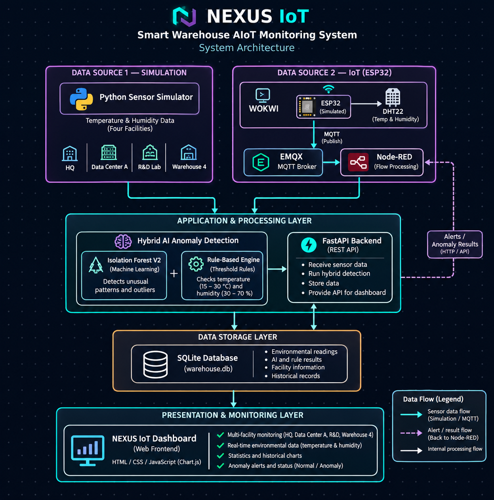
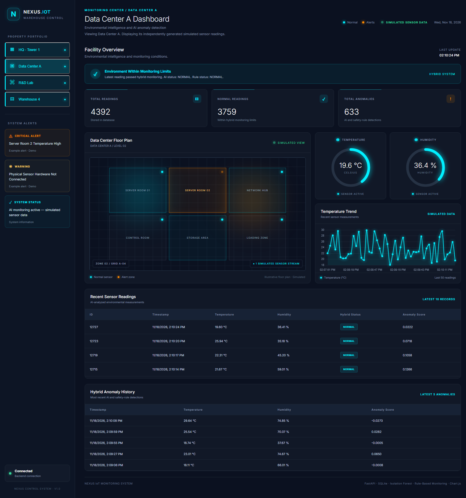

# NEXUS IoT — Smart Warehouse AIoT Monitoring System

**An intelligent multi-facility environmental monitoring prototype combining IoT communication, machine learning, rule-based anomaly detection, and real-time visualization.**

**Project:** Smart Warehouse AIoT Monitoring System  
**University:** Dalian Polytechnic University  
**Academic Year:** 2026–2027

## Project Overview

NEXUS IoT is an AIoT monitoring prototype developed using Python, FastAPI, SQLite, MQTT, Node-RED, ESP32 simulation, and modern web technologies.

The system monitors temperature and humidity across four facilities and identifies unusual environmental conditions using a hybrid anomaly detection approach.

The hybrid detection system combines a trained Isolation Forest V2 machine learning model with configurable environmental thresholds.

The project supports two sensor data sources:

1. **Python Sensor Simulator:** Generates environmental readings for the four facilities.
2. **Wokwi ESP32 Simulation:** Simulates an ESP32 microcontroller connected to a DHT22 temperature and humidity sensor. Readings are transmitted using MQTT, processed by Node-RED, and forwarded to FastAPI.

The ESP32 integration currently targets Warehouse 4.

**Important:** This is an educational prototype. ESP32 and DHT22 hardware are simulated using Wokwi. MQTT communication and Node-RED integration have been implemented and tested, but physical sensor deployment has not been performed.

## Monitored Facilities

| Facility ID | Facility |
|---|---|
| `hq` | HQ - Tower 1 |
| `data-center` | Data Center A |
| `rnd` | R&D Lab |
| `warehouse` | Warehouse 4 |

Each facility has facility-specific monitoring information and environmental readings.

Warehouse 4 additionally supports simulated ESP32 sensor readings received through MQTT and Node-RED.

## Main Features

- Multi-facility temperature and humidity monitoring.
- Python-based environmental sensor simulation.
- ESP32 and DHT22 simulation using Wokwi.
- MQTT communication through an EMQX public broker.
- Node-RED integration for sensor data processing.
- Temperature and humidity monitoring branches in Node-RED.
- Real-time AI anomaly alert indicators in Node-RED.
- SQLite database with facility identifiers.
- Isolation Forest V2 machine learning anomaly detection.
- Rule-based environmental threshold monitoring.
- Hybrid AI and rule-based anomaly classification.
- Detection source indicators.
- FastAPI REST endpoints for monitoring and sensor ingestion.
- Facility-specific statistics and readings.
- Interactive dashboard with charts and gauges.
- Recent sensor readings and anomaly history.
- Automatic dashboard data updates.
- Backend connection status monitoring.
- Demonstration of normal and abnormal environmental conditions.

## Technologies

| Component | Technology |
|---|---|
| Programming language | Python |
| Backend | FastAPI |
| Machine learning | Scikit-learn |
| AI algorithm | Isolation Forest |
| Feature scaling | StandardScaler |
| Model persistence | Joblib |
| Database | SQLite |
| Microcontroller simulation | Wokwi ESP32 |
| Environmental sensor | DHT22 (simulated) |
| Microcontroller programming | Arduino C++ |
| Communication protocol | MQTT |
| MQTT broker | EMQX public broker |
| IoT data processing | Node-RED |
| Frontend | HTML, CSS, JavaScript |
| Visualization | Chart.js |
| API server | Uvicorn |

## System Architecture

NEXUS IoT supports two environmental data acquisition workflows.

### Workflow A — Python Sensor Simulation

1. The Python simulator generates temperature and humidity readings.
2. Measurements are stored in SQLite with facility identifiers.
3. Isolation Forest V2 analyzes environmental patterns.
4. Rule-based monitoring checks temperature and humidity limits.
5. Hybrid decision logic combines both detection results.
6. FastAPI exposes monitoring data through REST endpoints.
7. The dashboard displays measurements, statistics, charts, and alerts.

### Workflow B — ESP32, MQTT, and Node-RED

1. Wokwi simulates an ESP32 connected to a DHT22 sensor.
2. The ESP32 reads temperature and humidity measurements.
3. The ESP32 publishes JSON messages to an MQTT broker.
4. Node-RED subscribes to the sensor topic.
5. Node-RED processes temperature and humidity readings through separate monitoring branches.
6. Node-RED forwards sensor measurements to FastAPI using an HTTP POST request.
7. FastAPI validates and stores the readings in SQLite.
8. Isolation Forest V2 and the rule engine analyze the measurements.
9. FastAPI returns the hybrid anomaly analysis.
10. Node-RED displays the returned analysis and updates its anomaly alert indicator.
11. The NEXUS dashboard retrieves the stored monitoring information through FastAPI.

### ESP32 Data Pipeline

```text
Wokwi ESP32 + DHT22
         |
         v
    MQTT Broker
         |
         v
      Node-RED
         |
         +---- Temperature Monitoring
         |
         +---- Humidity Monitoring
         |
         +---- HTTP POST to FastAPI
                       |
                       v
                  SQLite Database
                       |
                       v
              Isolation Forest V2
                       +
                Rule-Based Engine
                       |
                       v
                 Hybrid Decision
                       |
              +--------+--------+
              |                 |
              v                 v
       Node-RED Alerts    NEXUS Dashboard
```

The AI model executes in the Python backend, not on the ESP32 or inside Node-RED.

### Architecture Diagram



*Note: The architecture image should be updated to include the ESP32, MQTT, and Node-RED integration.*

### Dashboard Preview



## Project Structure

```text
Smart_Warehouse_AIOT/
├── backend/
│   ├── ai_model.py
│   ├── ai_model_v2.py
│   ├── database.py
│   ├── main.py
│   ├── sensor.py
│   └── test_ai_model_v2.py
├── data/
├── documentation/
│   ├── architecture.md
│   ├── requirements.md
│   ├── final_project_report.md
│   └── nexus-iot-flow-final.json
├── frontend/
│   ├── index.html
│   ├── script.js
│   └── style.css
├── models/
│   └── isolation_forest_v2.joblib
├── screenshots/
├── requirements.txt
└── README.md
```

The Node-RED flow is included as a JSON export. The Wokwi ESP32 simulation is maintained separately.

## Installation and Setup

### 1. Clone the Repository

```powershell
git clone https://github.com/louziatarik/Smart_Warehouse_AIOT.git
cd Smart_Warehouse_AIOT
```

### 2. Create a Virtual Environment

```powershell
python -m venv .venv
```

Activate the environment on Windows PowerShell:

```powershell
.\.venv\Scripts\Activate.ps1
```

### 3. Install Dependencies

```powershell
python -m pip install -r requirements.txt
```

### 4. Start the FastAPI Backend

From the project root:

```powershell
python -m uvicorn main:app --reload --app-dir backend
```

Backend URL:

`http://127.0.0.1:8000`

API documentation:

`http://127.0.0.1:8000/docs`

### 5. Start the Python Sensor Simulator (Optional)

Open another terminal:

```powershell
python backend/sensor.py
```

This simulator generates environmental readings for the configured facilities.

For a controlled ESP32 demonstration, the Python simulator can be stopped to avoid mixing synthetic Python readings with incoming ESP32 measurements.

### 6. Start the Frontend

From the project root:

```powershell
python -m http.server 5500
```

Open:

`http://127.0.0.1:5500/frontend/index.html`

The dashboard automatically retrieves monitoring information from FastAPI.

### 7. Configure Node-RED

Install Node-RED if it is not already available:

```powershell
npm install -g node-red
```

Start Node-RED:

```powershell
node-red
```

Open:

`http://127.0.0.1:1880`

Import the saved flow from:

`documentation/nexus-iot-flow-final.json`

Configure the MQTT connection and confirm the FastAPI endpoint is reachable.

### 8. Configure the Wokwi ESP32 Simulation

Create an ESP32 project in Wokwi using:

- ESP32 DevKit.
- DHT22 temperature and humidity sensor.
- Green LED for normal environmental conditions.
- Red LED for abnormal environmental conditions.

The ESP32 connects to Wokwi's simulated Wi-Fi network and publishes environmental readings using MQTT.

**MQTT broker:** `broker.emqx.io`  
**MQTT port:** `1883`  
**MQTT topic:** `nexus-iot-tarik-2026/warehouse/sensors`

The MQTT payload contains:

```json
{
  "facility_id": "warehouse",
  "device_id": "esp32-wokwi-01",
  "temperature": 24.6,
  "humidity": 55,
  "rule_status": "NORMAL"
}
```

The public MQTT broker is intended for demonstration purposes only. Do not publish credentials or sensitive data.

## Hybrid Anomaly Detection

The system combines machine learning and environmental threshold rules.

### Isolation Forest V2

The trained model analyzes four features:

1. Temperature.
2. Humidity.
3. Absolute temperature change.
4. Absolute humidity change.

The model uses StandardScaler and Isolation Forest with 200 estimators and a contamination setting of 0.05.

Saved model:

`models/isolation_forest_v2.joblib`

### Rule-Based Monitoring

| Parameter | Minimum | Maximum |
|---|---|---|
| Temperature | 15°C | 30°C |
| Humidity | 30% | 70% |

These are configurable demonstration thresholds, not universal warehouse safety standards.

### Hybrid Classification

A reading is classified as anomalous when either the AI model or the rule engine detects an anomaly.

The system reports:

- `ai_status` — Machine learning classification.
- `rule_status` — Rule-based classification.
- `status` — Final hybrid classification.
- `anomaly_score` — Isolation Forest decision score.
- `rule_alerts` — Triggered environmental threshold alerts.

## Testing

### AI Model Scenario Testing

Run:

```powershell
python backend/test_ai_model_v2.py
```

The scenarios include normal conditions, high temperature, high humidity, and rapid temperature changes.

These are functional tests rather than formal measurements of real-world model accuracy.

### ESP32 and Node-RED Integration Testing

The complete communication pipeline was tested using Wokwi, MQTT, Node-RED, FastAPI, and SQLite.

| Test | Temperature | Humidity | AI Result | Rule Result |
|---|---|---|---|---|
| Normal environment | 24.6°C | 55% | NORMAL | NORMAL |
| High-temperature anomaly | 40.5°C | 55% | ANOMALY | ANOMALY |

During the high-temperature test:

- The ESP32 published the abnormal measurement successfully.
- Node-RED received the MQTT message.
- Temperature Monitoring classified the reading as anomalous.
- Humidity Monitoring remained normal.
- FastAPI stored the measurement successfully.
- Isolation Forest V2 detected an anomaly.
- Node-RED received the backend analysis and displayed the anomaly result.

These results demonstrate functional integration using simulated sensor measurements.

## API Endpoints

| Method | Endpoint | Purpose |
|---|---|---|
| GET | `/` | API running status |
| GET | `/api/health` | Backend and AI model status |
| GET | `/api/facilities` | Configured monitoring facilities |
| GET | `/api/readings` | Environmental readings and classifications |
| GET | `/api/summary` | Monitoring statistics |
| POST | `/api/sensors/esp32` | Receive ESP32 sensor readings from Node-RED |

Facility-specific example:

`http://127.0.0.1:8000/api/summary?facility_id=warehouse`

The ESP32 endpoint validates the incoming JSON, stores the reading, performs hybrid anomaly analysis, and returns the analysis to Node-RED.

## Documentation

- `documentation/architecture.md` — System architecture.
- `documentation/requirements.md` — Functional and technical requirements.
- `documentation/final_project_report.md` — Detailed final project report.
- `documentation/nexus-iot-flow-final.json` — Exported Node-RED integration flow.

## Limitations and Future Improvements

The current implementation is an educational prototype rather than a production warehouse monitoring system.

Current limitations include:

- Physical ESP32 and DHT22 hardware have not been deployed.
- Sensor measurements are simulated.
- The MQTT broker is public and uses an unencrypted demonstration connection.
- The system is designed for