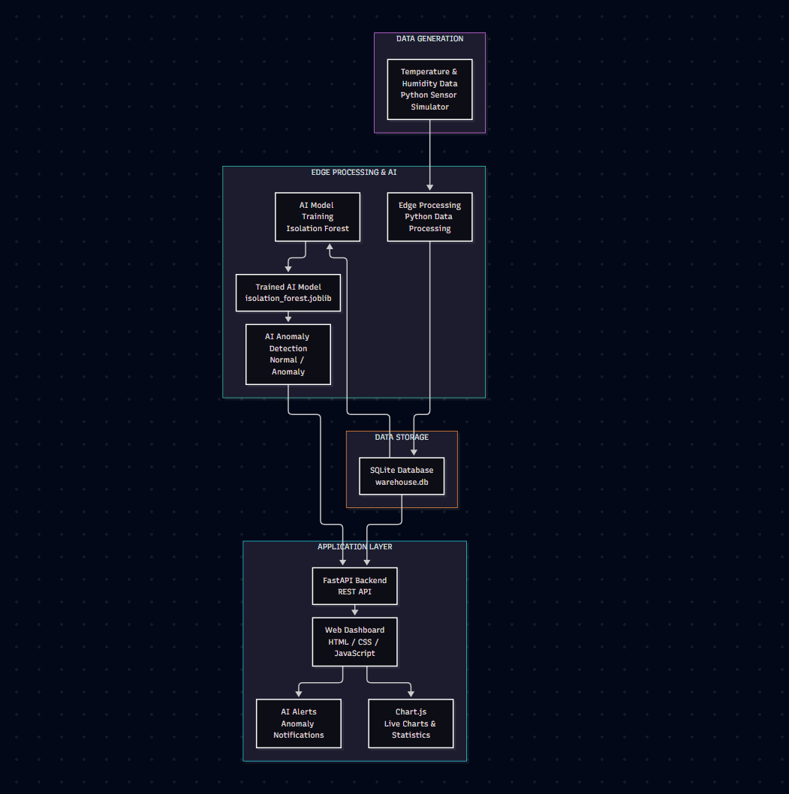

# Smart Warehouse AIoT Monitoring System Using Hybrid AI Anomaly Detection

**Project Type:** Artificial Intelligence of Things (AIoT)

**Project Domain:** Smart Warehouse Monitoring

**Student:** Tarik Louzia

**University:** Dalian Polytechnic University

**Major:** Computer Science and Technology

**Academic Year:** 2026–2027

---

# Abstract

Warehouse environments require environmental monitoring to help maintain appropriate storage conditions. Temperature and humidity variations may affect stored products, making continuous monitoring and anomaly identification important.

This project presents a Smart Warehouse AIoT Monitoring System that combines machine learning-based anomaly detection with rule-based environmental monitoring.

The system generates temperature and humidity readings using a Python-based sensor simulator. The readings are processed and stored in an SQLite database. An Isolation Forest V2 model analyzes environmental patterns, while a configurable rule engine checks measurements against predefined temperature and humidity limits.

A FastAPI backend provides monitoring information through REST API endpoints. A web-based dashboard developed using HTML, CSS, JavaScript, and Chart.js presents environmental measurements, historical data, system statistics, and hybrid anomaly alerts.

The current implementation is a functional software prototype using simulated sensor data. It demonstrates the integration of IoT-style data generation, machine learning, rule-based monitoring, database management, and web technologies. Physical sensor integration and MQTT communication remain possible future improvements.

**Keywords:** AIoT, Smart Warehouse, Internet of Things, Machine Learning, Isolation Forest, Hybrid Anomaly Detection, FastAPI, SQLite.

---

# 1. Introduction

## 1.1 Background

Warehouses play an important role in the storage and distribution of products. Environmental conditions, particularly temperature and humidity, can influence product quality and storage requirements.

Manual monitoring may not provide continuous analysis of environmental measurements. IoT technologies provide a way to collect environmental data automatically, while artificial intelligence can help identify unusual patterns in the collected measurements.

Combining these technologies can support more effective environmental monitoring.

## 1.2 Problem Statement

Warehouse environmental monitoring requires a system capable of collecting, storing, analyzing, and presenting temperature and humidity measurements.

A monitoring approach based only on predefined limits may fail to identify unusual patterns within otherwise acceptable measurements. Similarly, a machine learning model may not always identify absolute environmental limit violations.

This project addresses these limitations by combining machine learning anomaly detection with rule-based environmental checks.

## 1.3 Project Objectives

The main objectives are:

1. Develop a system for collecting temperature and humidity readings.
2. Simulate environmental sensor data.
3. Store measurements in an SQLite database.
4. Implement machine learning-based anomaly detection.
5. Implement configurable environmental safety rules.
6. Combine AI and rule-based results into a hybrid monitoring system.
7. Develop a REST API using FastAPI.
8. Create a web dashboard for displaying monitoring information.
9. Visualize historical temperature and humidity measurements.
10. Display anomaly alerts and detection sources.

## 1.4 Scope of the Project

The current project focuses on a software-based AIoT prototype.

Its implementation includes:

- Simulated temperature and humidity readings.
- Python-based data processing.
- SQLite database storage.
- Isolation Forest V2 anomaly detection.
- Rule-based environmental monitoring.
- Hybrid anomaly classification.
- FastAPI backend services.
- Browser-based monitoring dashboard.

Physical sensors, MQTT communication, and real-world warehouse deployment are outside the current implementation scope.

---

## 2.1 Architecture Overview

The Smart Warehouse AIoT Monitoring System uses a modular, multi-facility architecture.

The prototype monitors four simulated facilities:

1. HQ - Tower 1 (`hq`).
2. Data Center A (`data-center`).
3. R&D Lab (`rnd`).
4. Warehouse 4 (`warehouse`).

The system consists of five main layers:

1. **Sensor Simulation Layer:** Generates temperature and humidity measurements for each facility.
2. **Backend Processing Layer:** Handles data validation, database access, and API requests.
3. **Hybrid Detection Layer:** Combines Isolation Forest V2 anomaly detection with rule-based environmental monitoring.
4. **Database Layer:** Stores timestamped measurements with their corresponding facility identifiers.
5. **Dashboard Layer:** Displays facility-specific environmental information, charts, statistics, and anomaly history.

All four facilities share the same FastAPI backend, SQLite database, and trained Isolation Forest V2 model.

The current implementation is a software prototype using simulated environmental measurements rather than physical IoT sensors.

## 2.2 Data Flow

The system follows this process:

1. The Python sensor simulator generates independent temperature and humidity readings for each of the four facilities.
2. Each reading is associated with a unique `facility_id`.
3. The readings are stored in the SQLite database.
4. The backend retrieves environmental measurements and prepares the features required by Isolation Forest V2.
5. The AI model analyzes temperature, humidity, and changes between measurements.
6. The rule-based monitoring component checks readings against the configured environmental thresholds.
7. Hybrid decision logic combines the AI and rule-based classifications.
8. FastAPI provides facility-specific readings, statistics, and monitoring information through REST endpoints.
9. The JavaScript dashboard requests updated information automatically every five seconds.
10. Users select a facility from the sidebar to view its environmental measurements, charts, and anomaly history.

The multi-facility architecture allows the prototype to demonstrate monitoring of several locations through one centralized interface.

The shared AI model is trained using available simulated data and has not been independently validated for each facility.

## 2.3 Architecture Diagram

The system architecture diagram is available at:

The diagram illustrates the main components of the Smart Warehouse AIoT Monitoring System and their interactions.

The implemented system includes simulated environmental data generation, a Python backend, SQLite database storage, Isolation Forest anomaly detection, rule-based environmental monitoring, REST API communication, and a web dashboard.

The architecture has subsequently been extended to support four monitored facilities and hybrid anomaly detection using Isolation Forest V2.

# 3. Technologies and Development Tools

| Technology | Purpose |
|---|---|
| Python | Main programming language and data processing |
| FastAPI | Backend REST API |
| SQLite | Environmental measurement storage |
| Scikit-learn | Machine learning |
| Isolation Forest | Anomaly detection |
| StandardScaler | Feature scaling |
| Joblib | Model persistence |
| HTML | Dashboard structure |
| CSS | Dashboard styling |
| JavaScript | Frontend functionality |
| Chart.js | Data visualization |
| Uvicorn | Running the backend |
| Visual Studio Code | Development environment |

## 3.1 Development Environment

The project was developed using Visual Studio Code on Windows.

Python 3.13.15 was used as the programming environment. A Python virtual environment was created to manage dependencies.

The project separates backend, frontend, data, models, documentation, and screenshots into different directories.

---

# 4. Database Design

## 4.1 Database Overview

The project uses SQLite as its database management system.

SQLite was selected because it is lightweight and can be integrated directly with Python.

The database file is:

`data/warehouse.db`

## 4.2 Database Table

The system uses a SQLite table named `sensor_readings` to store environmental measurements from four monitored facilities.

| Field | Data Type | Description |
|---|---|---|
| id | INTEGER | Unique reading identifier and primary key |
| timestamp | TEXT | Date and time of the measurement |
| temperature | REAL | Temperature measurement in degrees Celsius |
| humidity | REAL | Relative humidity percentage |
| facility_id | TEXT | Identifier of the monitored facility |

The `id` field automatically increases for each new measurement.

The `facility_id` field identifies the facility associated with each reading.

The system currently supports four facilities:

| Facility ID | Facility Name |
|---|---|
| `hq` | HQ - Tower 1 |
| `data-center` | Data Center A |
| `rnd` | R&D Lab |
| `warehouse` | Warehouse 4 |

The database supports facility-specific filtering, allowing the backend to retrieve measurements for an individual facility.

Existing historical readings were preserved during the database upgrade and assigned to Data Center A.

The current implementation uses one SQLite database for all four facilities.

## 4.3 Database Operations

The database module supports:

- Database initialization.
- Creation of the sensor readings table.
- Insertion of environmental measurements.
- Retrieval of stored readings.
- Retrieval of recent measurements.

The database maintains the historical measurements used by the monitoring system.

---

# 5. Artificial Intelligence Implementation

## 5.1 Machine Learning Algorithm

The project uses the Isolation Forest algorithm from Scikit-learn.

Isolation Forest is an unsupervised machine learning algorithm designed to identify observations that differ from learned data patterns.

The current V2 model uses four input features:

1. Temperature.
2. Humidity.
3. Absolute temperature change.
4. Absolute humidity change.

Including environmental changes allows the model to analyze both measurement values and changes between consecutive readings.

## 5.2 Model Architecture and Configuration

The V2 model uses a processing pipeline containing StandardScaler and Isolation Forest.

| Parameter | Value |
|---|---|
| Algorithm | Isolation Forest |
| Model version | V2 |
| Number of estimators | 200 |
| Contamination | 0.05 |
| Random state | 42 |
| Input features | 4 |
| Feature scaling | StandardScaler |

The trained model is saved using Joblib at:

`models/isolation_forest_v2.joblib`

This allows the backend to load the trained model without retraining it every time the application starts.

## 5.3 Anomaly Detection Process

The model analyzes environmental readings and returns a prediction:

- **Normal (1):** The observation is not classified as anomalous.
- **Anomaly (-1):** The observation is classified as unusual compared with learned patterns.

The model also provides an anomaly decision score.

The score helps indicate how an observation relates to the model's learned decision boundary. It should not be interpreted as a probability of an environmental problem.

## 5.4 Model Testing

The V2 model was tested using controlled environmental scenarios.

| Scenario | AI Classification |
|---|---|
| Normal environment | NORMAL |
| High temperature | NORMAL |
| High humidity | NORMAL |
| Rapid temperature change | ANOMALY |

These tests demonstrated an important limitation: the model can identify unusual patterns but may not independently detect every absolute environmental limit violation.

This motivated the addition of rule-based monitoring.

The tests are controlled functional checks and do not represent a formal accuracy evaluation using a labelled dataset.

## 5.5 AI Model Limitations

The model learns patterns from the available simulated training data.

Its predictions depend on the characteristics of the training dataset. It does not directly predict product spoilage or determine whether conditions are safe for specific products.

Additional representative data and formal evaluation would be necessary before using the model in a real warehouse.

---

# 6. Rule-Based Environmental Monitoring

## 6.1 Purpose

The rule-based monitoring component complements machine learning by checking whether environmental measurements exceed configured limits.

Unlike the AI model, which identifies unusual patterns, the rule engine directly checks temperature and humidity values against predefined thresholds.

## 6.2 Configured Thresholds

The current prototype uses the following demonstration settings:

| Parameter | Minimum | Maximum |
|---|---:|---:|
| Temperature | 15 °C | 30 °C |
| Humidity | 30% | 70% |

These are configurable project demonstration limits. They are not universal warehouse standards or validated storage requirements for specific products.

## 6.3 Rule-Based Detection

The rule engine checks each measurement.

Possible alerts include:

- `TEMPERATURE_OUT_OF_RANGE`
- `HUMIDITY_OUT_OF_RANGE`

A reading is classified as a rule-based anomaly if either configured environmental limit is exceeded.

---

# 7. Hybrid AI and Rule-Based Detection

## 7.1 Hybrid Monitoring Approach

The main improvement in the current project is the integration of AI-based anomaly detection and rule-based environmental monitoring.

The two methods have complementary purposes:

- Isolation Forest identifies unusual environmental patterns.
- The rule engine detects violations of configured temperature and humidity limits.

Combining both methods provides a more comprehensive monitoring approach than using either method independently.

## 7.2 Hybrid Decision Logic

The final classification follows these rules:

| AI Result | Rule Result | Final Classification |
|---|---|---|
| ANOMALY | NORMAL | ANOMALY |
| NORMAL | ANOMALY | ANOMALY |
| ANOMALY | ANOMALY | ANOMALY |
| NORMAL | NORMAL | NORMAL |
| Model unavailable | NORMAL | UNKNOWN |

If both methods identify an issue, the dashboard can indicate that both AI and rules detected it.

The system also identifies the detection source:

- AI
- RULES
- AI + RULES
- UNKNOWN

## 7.3 Hybrid Testing

The hybrid anomaly detection system was evaluated using four controlled environmental scenarios.

Each scenario was processed using Isolation Forest V2 and the rule-based environmental monitoring component.

The final hybrid classification was determined by combining both detection results.

### Test Results

| Test Scenario | AI Result | Rule Result | Final Hybrid Result |
|---|---|---|---|
| Normal warehouse conditions (24°C, 55%) | NORMAL | NORMAL | NORMAL |
| High temperature (45°C, 55%) | NORMAL | ANOMALY | ANOMALY |
| Very high humidity (24°C, 95%) | NORMAL | ANOMALY | ANOMALY |
| Rapid temperature increase (35°C, 55%) | ANOMALY | ANOMALY | ANOMALY |

### Analysis

The normal environmental scenario was classified as NORMAL by both detection methods.

In the high-temperature scenario, Isolation Forest V2 classified the reading as NORMAL. However, the rule-based component identified that the temperature exceeded the configured maximum of 30°C.

Similarly, the very-high-humidity scenario was classified as NORMAL by the AI model, while the rule-based component detected that humidity exceeded the configured maximum of 70%.

In the rapid-temperature-increase scenario, both the AI model and rule-based component classified the reading as anomalous.

These results demonstrate the complementary behavior of the two monitoring methods.

The hybrid system successfully identified the three abnormal conditions in the controlled scenarios, even when the AI model alone did not classify all of them as anomalies.

### Testing Limitations

These tests verify the functional behavior of the hybrid classification logic for the selected scenarios.

They do not establish real-world anomaly detection accuracy, precision, recall, or production-level reliability.

Additional representative datasets and formal evaluation would be required before deployment in an operational warehouse.

# 8. Backend Development

## 8.1 FastAPI Backend

The backend was developed using FastAPI.

It connects the database, AI model, rule engine, and frontend dashboard.

The main backend components include:

| File | Responsibility |
|---|---|
| `main.py` | API endpoints and hybrid monitoring logic |
| `database.py` | SQLite database operations |
| `sensor.py` | Sensor data simulation |
| `ai_model_v2.py` | V2 model preparation and training |
| `main_backup.py` | Backup of the previous backend implementation |

## 8.2 API Endpoints

The FastAPI backend provides REST endpoints for accessing system information, environmental measurements, facility information, and hybrid anomaly detection results.

| Endpoint | Method | Description |
|---|---|---|
| `/` | GET | Returns the API running status |
| `/api/health` | GET | Returns API status, AI model information, and monitoring mode |
| `/api/facilities` | GET | Returns information about the four monitored facilities |
| `/api/readings` | GET | Retrieves sensor readings and hybrid anomaly classifications |
| `/api/summary` | GET | Returns monitoring statistics and the latest sensor reading |

### Facility-Specific Monitoring

The `/api/readings` and `/api/summary` endpoints support facility-specific data retrieval using the `facility_id` query parameter.

For example:

`GET /api/readings?limit=50&facility_id=data-center`

This request retrieves up to 50 recent readings associated with Data Center A.

`GET /api/summary?facility_id=warehouse`

This request returns monitoring statistics for Warehouse 4.

### API Health Monitoring

The `/api/health` endpoint provides information about:

- Backend availability.
- AI model loading status.
- AI model version.
- Number of AI input features.
- Hybrid monitoring mode.
- Number of configured facilities.

The API exchanges information with the frontend using JSON.

### Frontend Communication

The frontend communicates with FastAPI using JavaScript Fetch API requests.

Cross-Origin Resource Sharing (CORS) is configured to allow communication between the local frontend server and the backend.

The backend runs on port 8000, while the frontend is served locally on port 5501.

## 8.3 Backend Execution

The backend is launched using Uvicorn:

`python -m uvicorn main:app --reload --app-dir backend`

The local API address is:

`http://127.0.0.1:8000`

Interactive API documentation is available at:

`http://127.0.0.1:8000/docs`

---

# 9. Frontend Dashboard Development

## 9.1 Dashboard Overview

The frontend provides a browser-based interface for monitoring warehouse environmental conditions.

It was developed using HTML, CSS, JavaScript, and Chart.js.

The dashboard retrieves monitoring information from the FastAPI backend.

## 9.2 Dashboard Features

The dashboard includes:

1. Temperature monitoring.
2. Humidity monitoring.
3. Total sensor readings.
4. Normal and anomalous reading statistics.
5. Temperature and humidity charts.
6. Recent sensor readings table.
7. Hybrid anomaly history.
8. AI and rule-based detection source indicators.
9. Environmental alert messages.
10. Backend connection status.

## 9.3 Hybrid Alert Display

The dashboard distinguishes between different detection sources.

Examples include:

- `AI + SAFETY ALERT`
- `ENVIRONMENTAL LIMIT EXCEEDED`
- `AI ANOMALY DETECTED`
- `HYBRID MONITORING ACTIVE`

The readings table also displays the final classification and its detection source.

## 9.4 Dashboard Data Updates

The dashboard automatically retrieves updated monitoring information from the FastAPI backend every five seconds.

JavaScript uses the Fetch API to request facility-specific sensor readings and monitoring statistics without reloading the entire webpage.

The automatic update process refreshes:

- Current temperature and humidity measurements.
- Total, normal, and anomalous reading statistics.
- Temperature and humidity visualizations.
- Recent sensor readings.
- Hybrid anomaly history.
- Monitoring alerts and backend connection status.

Users can switch between four monitored facilities:

1. HQ - Tower 1.
2. Data Center A.
3. R&D Lab.
4. Warehouse 4.

Each facility has independently generated simulated sensor readings stored with a unique facility identifier.

The dashboard preserves its scroll position during automatic updates, allowing users to inspect historical records without interruption.

The frontend is served locally using Python's HTTP server on port 5501. FastAPI is configured to permit cross-origin requests from the local frontend.

---

# 10. System Testing and Results

## 10.1 Testing Environment

The prototype was tested locally on Windows using:

- Python sensor simulator.
- SQLite database.
- Isolation Forest V2 model.
- Rule-based monitoring.
- FastAPI backend.
- Browser-based dashboard.
- Chart.js visualizations.

## 10.2 Functional Testing

The Smart Warehouse AIoT Monitoring System was tested locally to verify the integration of its main components.

| Test | Expected Result | Result |
|---|---|---|
| Database initialization | SQLite database initializes successfully | Passed |
| Sensor simulation | Simulated environmental readings are generated | Passed |
| Multi-facility simulation | Readings are generated for four facilities | Passed |
| Database storage | Readings are stored with facility identifiers | Passed |
| AI model loading | Isolation Forest V2 loads successfully | Passed |
| AI scenario testing | Model returns classifications and scores | Passed |
| Temperature threshold test | Temperature violations are detected | Passed |
| Humidity threshold test | Humidity violations are detected | Passed |
| Hybrid classification | AI and rule-based results are combined | Passed |
| API health check | Backend reports online status | Passed |
| Facility information endpoint | API provides configured facility information | Passed |
| Facility-specific summary | API returns monitoring statistics for a selected facility | Passed |
| Facility-specific readings | API retrieves readings for a selected facility | Passed |
| Frontend connection | Dashboard communicates with FastAPI | Passed |
| CORS configuration | Frontend requests from port 5501 are accepted | Passed |
| Dashboard visualization | Measurements, statistics, and charts are displayed | Passed |
| Facility navigation | Users can select monitored facilities | Passed |
| Hybrid anomaly history | Historical anomalies and detection sources are displayed | Passed |
| Automatic data refresh | Dashboard retrieves updated data periodically | Passed |
| Dashboard scroll stability | Automatic updates do not reload the entire page | Passed |

### Testing Observations

The backend health endpoint confirmed that Isolation Forest V2 was loaded with four input features and that hybrid monitoring was active.

Facility-specific API requests successfully returned monitoring statistics.

Controlled AI tests demonstrated that the rule engine detected temperature and humidity violations that the AI model alone did not identify.

The dashboard successfully displayed hybrid anomaly history after the frontend server and CORS configuration were corrected.

Automatic dashboard updates use JavaScript requests rather than full-page reloads, allowing the interface to remain stable during monitoring.

These functional checks demonstrate that the main components operate together in the local prototype.

They do not establish production reliability, real-world sensor accuracy, or formal machine learning performance.

## 10.3 Testing Results

The testing demonstrated that the main software components work together.

The Python simulator generated environmental readings, and SQLite stored the measurements.

Isolation Forest V2 analyzed environmental patterns, while the rule engine checked configured environmental limits.

The FastAPI backend successfully returned hybrid monitoring information. The dashboard displayed environmental measurements, monitoring statistics, anomaly classifications, and detection sources.

The controlled tests also demonstrated that the rule engine can identify environmental limit violations that may not be detected by the AI model alone.

These results confirm the functional integration of the prototype's main components. They do not establish production-level reliability or formal machine learning accuracy.

## 10.4 Screenshots

The following evidence should be included in the final project documentation:

- System architecture diagram.
- Sensor simulator output.
- AI model testing output.
- FastAPI backend running.
- API health response.
- Main dashboard.
- Temperature and humidity charts.
- Sensor readings table.
- Hybrid anomaly alert.
- Rule-based detection test results.

Screenshots should be stored in the project's `screenshots` directory.

---

# 11. Limitations and Future Improvements

## 11.1 Current Limitations

The current Smart Warehouse AIoT Monitoring System is a functional software prototype with the following limitations:

1. **Simulated Sensor Data:** Temperature and humidity measurements are generated using Python rather than physical sensors.

2. **No MQTT Communication:** The prototype uses local software components and REST API communication. MQTT-based sensor communication has not been implemented.

3. **Limited Training Data:** Isolation Forest V2 was trained using available simulated environmental measurements rather than a representative real-world warehouse dataset.

4. **Shared AI Model:** All four monitored facilities use the same trained Isolation Forest V2 model. The model has not been independently trained or validated for each facility.

5. **Local Deployment:** The backend, database, and dashboard operate locally. Remote server deployment has not been implemented.

6. **Demonstration Thresholds:** The configured temperature range of 15–30°C and humidity range of 30–70% are demonstration settings, not universal storage safety standards.

7. **Limited Model Evaluation:** The controlled scenarios verify selected detection behaviors but do not provide formal accuracy, precision, recall, or false-positive-rate measurements.

8. **No Physical Actuation:** The system displays monitoring information and alerts but does not control physical warehouse equipment.

9. **No User Authentication:** The current prototype does not implement user accounts, role-based access control, or authentication for monitoring data.

These limitations define the boundaries of the current implementation and identify areas for future development.

## 11.2 Future Improvements

Future development could include:

- Integration of physical temperature and humidity sensors.
- ESP32 or Raspberry Pi hardware integration.
- MQTT communication for sensor data transmission.
- Collection of real warehouse environmental data.
- Product-specific environmental thresholds.
- Formal AI model performance evaluation.
- Additional dashboard analytics.
- Remote notifications and monitoring.
- Cloud or remote-server deployment.

These improvements could help extend the prototype into a more complete warehouse monitoring solution.

---

# 12. Conclusion

This project presented the development of a Smart Warehouse AIoT Monitoring System using hybrid anomaly detection.

The prototype integrates simulated environmental data generation, Python processing, SQLite storage, Isolation Forest V2, rule-based environmental monitoring, a FastAPI backend, and a web-based dashboard.

The main contribution is the combination of machine learning and configurable environmental rules. While the AI model identifies unusual environmental patterns, the rule engine checks measurements against predefined limits.

The hybrid approach helps address limitations associated with relying on machine learning alone or fixed thresholds alone.

The project demonstrates how AI and IoT-related technologies can be integrated into a practical environmental monitoring prototype.

Although physical sensor integration and real-world deployment remain future improvements, the current implementation provides a foundation for further development of intelligent warehouse monitoring systems.
